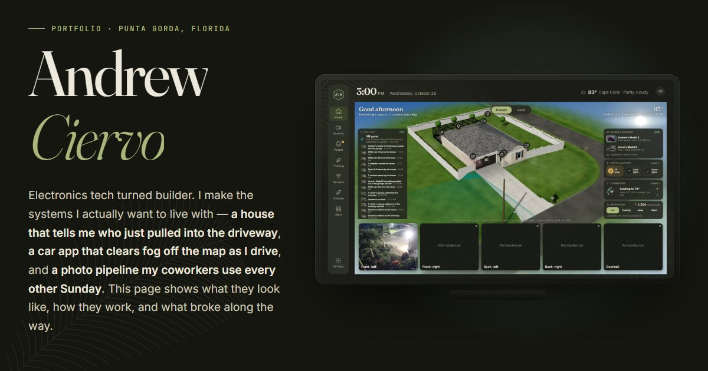

### Hi, I'm Andrew.

Electronics tech turned builder, in Southwest Florida. I make the systems I actually want to live with — and write down how they work.

**→ [See everything I've built, with screenshots and live demos](https://datbluepony.github.io/)**

| | |
|---|---|
| **[Uncharted](https://datbluepony.github.io/uncharted/)** | A Tesla-browser app: every road you drive clears the fog of war. WebGL, free data only, no API keys. |
| **[Pulte Pic System](https://datbluepony.github.io/pulte-pics/about.html)** | Reads a marked-up PDF map, plans the route around the lakes, shoots and delivers construction photos. |
| **[MONSOON S13](https://datbluepony.github.io/monsoon-s13/)** | A wiper/washer controller board for a 1993 240SX, with a browser test bench built from the PCB file. |
| **Cape House** *(private)* | Camera AI, spoken announcements and a 3D home screen, all on one Raspberry Pi. [How it works](https://datbluepony.github.io/#cape-house) |

[LinkedIn](https://www.linkedin.com/in/andrew-ciervo) · [Portfolio](https://datbluepony.github.io/)
